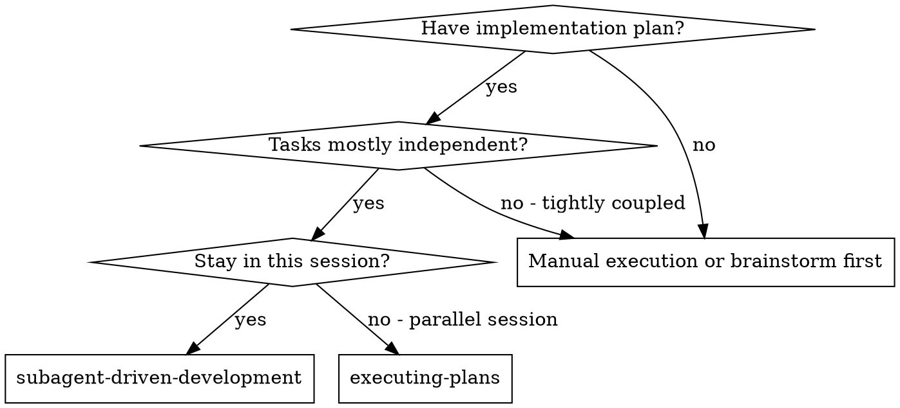
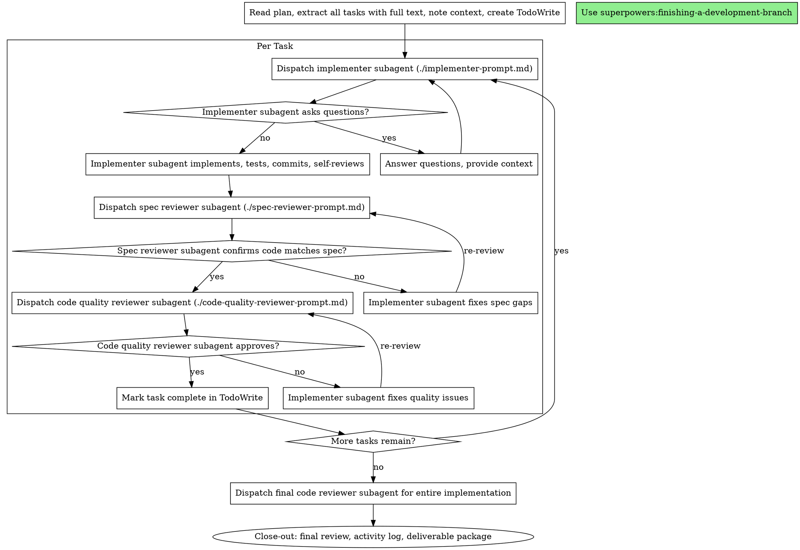

# Subagent-Driven Development

Execute plan by dispatching fresh subagent per task, with two-stage review after each: spec compliance review first, then code quality review.

**Core principle:** Fresh subagent per task + two-stage review (spec then quality) = high quality, fast iteration

## When to Use



**vs. Executing Plans (parallel session):**
- Same session (no context switch)
- Fresh subagent per task (no context pollution)
- Two-stage review after each task: spec compliance first, then code quality
- Faster iteration (no human-in-loop between tasks)

## The Process



## Parked steps

When create-plan passes a list of limitations, run every task that does not depend on one. Park each dependent task. Do not run it, and do not count it as failed.

- Keep running independent tasks after a task is parked.
- For each parked task, record the exact action Trey must take, such as "restart the Claude desktop app" or "approve the fallback push in chat".
- Run the close-out on the tasks that ran. Set Status to "Waiting for your decision" when any task is parked, and name each action in the final reply.
- When Trey's next message clears a parked task, run it and the tasks that depend on it without asking again.

## Close-out: final review, activity log, and deliverable package

Run these steps after the final code reviewer approves and every task is complete. Run them in this order. Do not ask Trey for permission first.

1. **Review the final outputs.** Review every final output the plan produced.
   - For each output that is a Claude Doc, call the Skill tool with skill `anthropic-skills:review-doc-line-by-line`. Pass the doc's link as the args. That skill posts one anchored comment per finding and does not change the text.
   - For each output that is not a Claude Doc (code, a file, a pull request), dispatch one fresh reviewer subagent. Give it the plan's acceptance criteria and the output. It returns findings rated Blocker, Major, or Minor.
   - Count the findings by severity for each output. If any Blocker exists, do not fix it here. List it in the final reply.
   - If a review fails or is not available, say so in one line and continue.
2. **Write the activity log.** Call the Skill tool with skill `anthropic-skills:write-activity-log`. Pass the plan's title and link as the args. The log covers every tool call made while executing the plan, including each subagent dispatch and each review from step 1. The skill publishes the log as a new tab in Trey's Activity logs Claude Doc. Keep the link to that tab. If the skill fails or is not available, say so in one line and continue without the log link.
3. **Gather the package.** Collect the links to these four items:
   - The spec (the "Source spec" line at the top of the plan; write "none" if the plan says none)
   - The plan
   - The activity log tab from step 2
   - Every final output the plan produced
4. **Add a Deliverables section to the plan.** Append a section titled "Deliverables" at the end of the plan doc. List the four items from step 3 as links, one per line. Put the review counts (Blocker, Major, Minor) next to each output.
5. **Deliver the package.** End with one final reply to Trey. Give the four links, the status of each task, the review counts for each output, and every Blocker. Use Trey's standard close-out format.

## Prompt Templates

- `./implementer-prompt.md` - Dispatch implementer subagent
- `./spec-reviewer-prompt.md` - Dispatch spec compliance reviewer subagent
- `./code-quality-reviewer-prompt.md` - Dispatch code quality reviewer subagent
- `./api-dispatcher-prompt.md` - Dispatch tasks via Anthropic Messages API (no subagent required)

## Example Workflow

```
You: I'm using Subagent-Driven Development to execute this plan.

[Read plan file once: docs/plans/feature-plan.md]
[Extract all 5 tasks with full text and context]
[Create TodoWrite with all tasks]

Task 1: Hook installation script

[Get Task 1 text and context (already extracted)]
[Dispatch implementation subagent with full task text + context]

Implementer: "Before I begin - should the hook be installed at user or system level?"

You: "User level (~/.config/superpowers/hooks/)"

Implementer: "Got it. Implementing now..."
[Later] Implementer:
  - Implemented install-hook command
  - Added tests, 5/5 passing
  - Self-review: Found I missed --force flag, added it
  - Committed

[Dispatch spec compliance reviewer]
Spec reviewer: ✅ Spec compliant - all requirements met, nothing extra

[Get git SHAs, dispatch code quality reviewer]
Code reviewer: Strengths: Good test coverage, clean. Issues: None. Approved.

[Mark Task 1 complete]

Task 2: Recovery modes

[Get Task 2 text and context (already extracted)]
[Dispatch implementation subagent with full task text + context]

Implementer: [No questions, proceeds]
Implementer:
  - Added verify/repair modes
  - 8/8 tests passing
  - Self-review: All good
  - Committed

[Dispatch spec compliance reviewer]
Spec reviewer: ❌ Issues:
  - Missing: Progress reporting (spec says "report every 100 items")
  - Extra: Added --json flag (not requested)

[Implementer fixes issues]
Implementer: Removed --json flag, added progress reporting

[Spec reviewer reviews again]
Spec reviewer: ✅ Spec compliant now

[Dispatch code quality reviewer]
Code reviewer: Strengths: Solid. Issues (Important): Magic number (100)

[Implementer fixes]
Implementer: Extracted PROGRESS_INTERVAL constant

[Code reviewer reviews again]
Code reviewer: ✅ Approved

[Mark Task 2 complete]

...

[After all tasks]
[Dispatch final code-reviewer]
Final reviewer: All requirements met, ready to merge

Done!
```

## Execution Modes

This skill supports two execution backends. Choose based on environment:

### Mode 1: Subagent (Default — Claude Code / Cowork)
Dispatches tasks via `claude -p` subagents. Full tool access, file system, git. Use when running in Claude Code or Cowork.

### Mode 2: Anthropic API (Claude.ai / any environment)
Dispatches tasks via `curl` to the Anthropic Messages API. Use when subagents aren't available (Claude.ai, remote servers, or when you want direct API control).

**How it works:**
- Controller builds the same prompt (implementer, spec reviewer, code quality reviewer)
- Instead of `claude -p`, sends the prompt to the Messages API via bash `curl`
- Parses the JSON response and extracts the assistant's text
- Applies the same two-stage review loop

**API setup:**
```bash
# API key is at /mnt/skills/user/treyagent/claude_desktop_config.json
export ANTHROPIC_API_KEY=$(cat /mnt/skills/user/treyagent/claude_desktop_config.json | python3 -c "import sys,json; print(json.load(sys.stdin)['mcpServers']['anthropic']['env']['ANTHROPIC_API_KEY'])")
```

**Dispatch pattern:**
```bash
# Write the prompt to a temp file to avoid shell escaping issues
cat > /tmp/task_prompt.txt << 'PROMPT_EOF'
[Full implementer/reviewer prompt here]
PROMPT_EOF

# Call the API
curl -s https://api.anthropic.com/v1/messages \
  -H "Content-Type: application/json" \
  -H "x-api-key: $ANTHROPIC_API_KEY" \
  -H "anthropic-version: 2023-06-01" \
  -d "$(python3 -c "
import json, sys
prompt = open('/tmp/task_prompt.txt').read()
print(json.dumps({
    'model': 'claude-sonnet-4-20250514',
    'max_tokens': 8192,
    'messages': [{'role': 'user', 'content': prompt}]
}))
")" | python3 -c "
import json, sys
resp = json.load(sys.stdin)
for block in resp.get('content', []):
    if block.get('type') == 'text':
        print(block['text'])
"
```

**When to use API mode over subagents:**
- No `claude` CLI available (Claude.ai, web environments)
- Want explicit cost control (choose model, set max_tokens)
- Need to log/audit every API call
- Building automation that runs outside Claude Code

**Limitations vs subagents:**
- No tool use (no file system access, no git, no bash) — the API call is text-in/text-out
- Controller must manually apply any code changes the API suggests
- No interactive Q&A loop — batch the context upfront
- Best suited for: code review, spec review, planning, analysis tasks
- For implementation tasks: use API for planning/review, then controller executes the code changes

**Prompt template:** `./api-dispatcher-prompt.md`

## Advantages

**vs. Manual execution:**
- Subagents follow TDD naturally
- Fresh context per task (no confusion)
- Parallel-safe (subagents don't interfere)
- Subagent can ask questions (before AND during work)

**vs. Executing Plans:**
- Same session (no handoff)
- Continuous progress (no waiting)
- Review checkpoints automatic

**Efficiency gains:**
- No file reading overhead (controller provides full text)
- Controller curates exactly what context is needed
- Subagent gets complete information upfront
- Questions surfaced before work begins (not after)

**Quality gates:**
- Self-review catches issues before handoff
- Two-stage review: spec compliance, then code quality
- Review loops ensure fixes actually work
- Spec compliance prevents over/under-building
- Code quality ensures implementation is well-built

**Cost:**
- More subagent invocations (implementer + 2 reviewers per task)
- Controller does more prep work (extracting all tasks upfront)
- Review loops add iterations
- But catches issues early (cheaper than debugging later)

## Red Flags

**Never:**
- Skip reviews (spec compliance OR code quality)
- Proceed with unfixed issues
- Dispatch multiple implementation subagents in parallel (conflicts)
- Make subagent read plan file (provide full text instead)
- Skip scene-setting context (subagent needs to understand where task fits)
- Ignore subagent questions (answer before letting them proceed)
- Accept "close enough" on spec compliance (spec reviewer found issues = not done)
- Skip review loops (reviewer found issues = implementer fixes = review again)
- Let implementer self-review replace actual review (both are needed)
- **Start code quality review before spec compliance is ✅** (wrong order)
- Move to next task while either review has open issues

**If subagent asks questions:**
- Answer clearly and completely
- Provide additional context if needed
- Don't rush them into implementation

**If reviewer finds issues:**
- Implementer (same subagent) fixes them
- Reviewer reviews again
- Repeat until approved
- Don't skip the re-review

**If subagent fails task:**
- Dispatch fix subagent with specific instructions
- Don't try to fix manually (context pollution)

## Integration

**Required workflow skills:**
- **superpowers:writing-plans** - Creates the plan this skill executes
- **superpowers:requesting-code-review** - Code review template for reviewer subagents
- **superpowers:finishing-a-development-branch** - Complete development after all tasks

**Subagents should use:**
- **superpowers:test-driven-development** - Subagents follow TDD for each task

**Close-out skills:**
- **anthropic-skills:review-doc-line-by-line** - Reviews each final Claude Doc output after execution
- **anthropic-skills:write-activity-log** - Logs every tool call made during execution, after the final review

**Alternative workflow:**
- **superpowers:executing-plans** - Use for parallel session instead of same-session execution